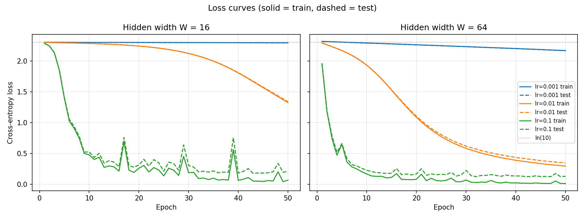
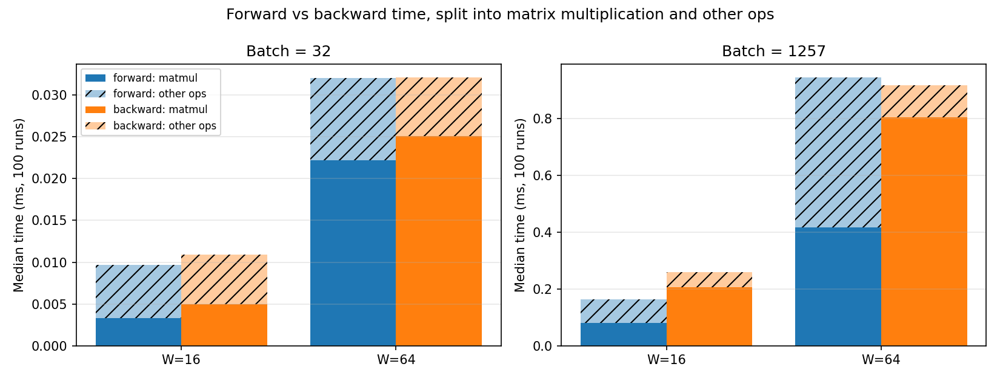

# Lab 2: A Neural Network from Scratch

## 1. Goal

Build a two-hidden-layer neural network using only NumPy: implement forward propagation, cross-entropy loss and backpropagation by hand, verify the gradients numerically, train it with different learning rates and hidden widths, and measure how forward and backward pass time relates to matrix multiplication.

## 2. Method

- **Environment:** same pinned environment as Lab 1 (Python 3.11.8, `requirements.txt`), versions in `results/versions.txt`. `OMP_NUM_THREADS=1` is set before any import (see Lab 1). All four seeds are set to 42.
- **Data:** `load_digits` (1,797 images of 8×8 pixels = 64 features), inputs divided by 16 to scale them to [0, 1], labels one-hot encoded to 10 columns, 70/30 stratified split with `random_state=42` (1,257 train / 540 test).
- **Architecture:** 64 → W → ReLU → W → ReLU → 10 → softmax, with W ∈ {16, 64}.

| Layer | Weight shape | Bias shape | Parameters (W=16) | Parameters (W=64) |
|---|---|---|---|---|
| Input → hidden 1 | (64, W) | (W,) | 1,040 | 4,160 |
| Hidden 1 → hidden 2 | (W, W) | (W,) | 272 | 4,160 |
| Hidden 2 → output | (W, 10) | (10,) | 170 | 650 |
| **Total** | | | **1,482** | **8,970** |

- **Initialisation:** weights drawn from N(0, 0.01), read in the standard N(μ, σ²) notation as variance 0.01 (standard deviation 0.1). Biases start at zero.
- **Loss:** mean cross-entropy, L = −(1/N) Σ log p(correct class).
- **Gradients (derived with the chain rule, N = batch size):**
  - dz3 = (probs − Y) / N  (softmax and cross-entropy combined)
  - dW3 = a2ᵀ dz3, db3 = Σ dz3
  - dz2 = (dz3 W3ᵀ) ⊙ 1[z2 > 0]  (ReLU derivative is 1 for positive inputs, 0 otherwise)
  - dW2 = a1ᵀ dz2, db2 = Σ dz2
  - dz1 = (dz2 W2ᵀ) ⊙ 1[z1 > 0]
  - dW1 = Xᵀ dz1, db1 = Σ dz1
- **Gradient check:** on a batch of 32 training samples, 10 randomly chosen weights per width were nudged by ±1e-5. The numerical slope (L₊ − L₋) / 2e-5 was compared with the analytic gradient using relative error |a − n| / max(|a|, |n|).
- **Training:** mini-batch SGD, batch size 32, data shuffled every epoch, 50 epochs, learning rates {0.001, 0.01, 0.1} × widths {16, 64}. Seeds are reset before each of the 6 runs, so all runs share the same initial weights and shuffling order. Train loss, test loss and test accuracy are logged after every epoch (`results/training_log.csv`).
- **Timing:** forward and backward passes timed separately, 1 warm-up and median of 100 runs, at batch 32 (training batch) and batch 1,257 (full train set). The matrix multiplications of each pass were also timed on their own, to split each pass into "matmul" and "other operations".

## 3. Results

### Sanity checks (`results/sanity_checks.txt`)

- Forward output shape is (batch, 10) and every row of the softmax sums to 1 within 3.3e-16 (requirement: 1e-6).
- Untrained loss on the training set: 2.3021 (W=16) and 2.3184 (W=64), close to ln(10) = 2.3026.

### Gradient check (`results/gradient_check.csv`)

| Width | Passed (rel. error < 1e-6) | Largest rel. error | Weights with zero gradient |
|---|---|---|---|
| 16 | 10/10 | 4.37e-07 | 1 |
| 64 | 10/10 | 3.95e-07 | 4 |

Both widths pass the requirement of at least 9/10. Some sampled weights have an exactly zero gradient because they connect to ReLU units that are inactive for the whole batch. These pass trivially; every non-zero gradient (9 for W=16, 6 for W=64) also passed, with relative errors between 6e-10 and 4e-7.

### Training (`results/final_accuracy.csv`)

| Width | Learning rate | Final train loss | Final test loss | Final test accuracy |
|---|---|---|---|---|
| 16 | 0.001 | 2.2931 | 2.2928 | 0.2167 |
| 16 | 0.01 | 1.3254 | 1.3405 | 0.5685 |
| 16 | 0.1 | 0.0684 | 0.2111 | 0.9481 |
| 64 | 0.001 | 2.1672 | 2.1650 | 0.3574 |
| 64 | 0.01 | 0.2965 | 0.3475 | 0.9000 |
| 64 | 0.1 | 0.0141 | 0.1317 | **0.9611** |

### Timing (`results/timing.csv`, median of 100 runs, ms)

| Width | Batch | Forward | Backward | Backward / forward | Matmul only: backward / forward | Theoretical MAC ratio | Matmul share of forward | Matmul share of backward |
|---|---|---|---|---|---|---|---|---|
| 16 | 32 | 0.0097 | 0.0109 | 1.13 | 1.50 | 1.29 | 34% | 46% |
| 16 | 1257 | 0.1636 | 0.2600 | 1.59 | 2.54 | 1.29 | 50% | 79% |
| 64 | 32 | 0.0320 | 0.0321 | 1.00 | 1.13 | 1.54 | 69% | 78% |
| 64 | 1257 | 0.9443 | 0.9157 | 0.97 | 1.93 | 1.54 | 44% | 88% |

The theoretical ratio counts multiply-accumulate operations (MACs). For a batch of N, the forward pass does 3 matrix multiplications with N(64W + W² + 10W) MACs. The backward pass does 5: one weight gradient per layer and one propagated gradient for each layer except the first, totalling N(64W + 2W² + 20W) MACs. The "other operations" part is the total time minus the separately timed matrix multiplications, so it is an estimate.

## 4. Conclusions

1. **Learning rate decides whether the network learns at all in 50 epochs, and width decides how fast.** With lr = 0.001 the loss barely moves away from ln(10) for either width, while lr = 0.1 reaches 94.8% (W=16) and 96.1% (W=64) test accuracy. The wider network learns faster at every learning rate; the gap is largest at lr = 0.01 (90.0% vs 56.9%). At lr = 0.1 the narrow network's loss curve shows spikes around epochs 17, 29 and 39, a sign that the step size is close to too large for it, while the wider network trains smoothly. A gap between train and test loss at lr = 0.1 (0.014 vs 0.132 for W=64) shows mild overfitting.
2. **Backward does more matrix multiplication work, and its matmul time confirms it.** The backward pass performs 5 matrix multiplications against 3 in the forward pass, which predicts it to be 1.29× (W=16) to 1.54× (W=64) more expensive. Timing only the matrix multiplications, backward is slower in all four cases (1.13× to 2.54×), and matrix multiplication makes up most of the backward time (46–88%). Backward matmuls are slower than the MAC count predicts at batch 1,257, likely because products with transposed operands such as aᵀ·dz are less efficient in memory.
3. **In a network this small, total time is not only matrix multiplication.** In the forward pass only 34–69% of the time is matrix multiplication; the rest goes to element-wise work (softmax exponentials, ReLU, bias addition) and creating new arrays. For W=64 at batch 1,257 this overhead is large enough that the full forward pass (0.94 ms) is slightly slower than the full backward pass (0.92 ms), even though backward does about 1.5× more MACs. At batch 32, both passes take only 10–30 µs, so fixed per-call overhead hides most of the difference. Matrix multiplication would dominate more clearly with larger layers and batches.
