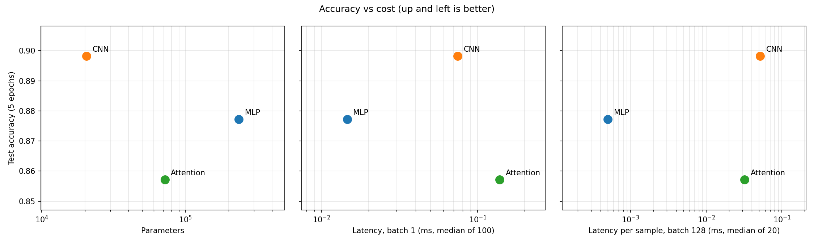
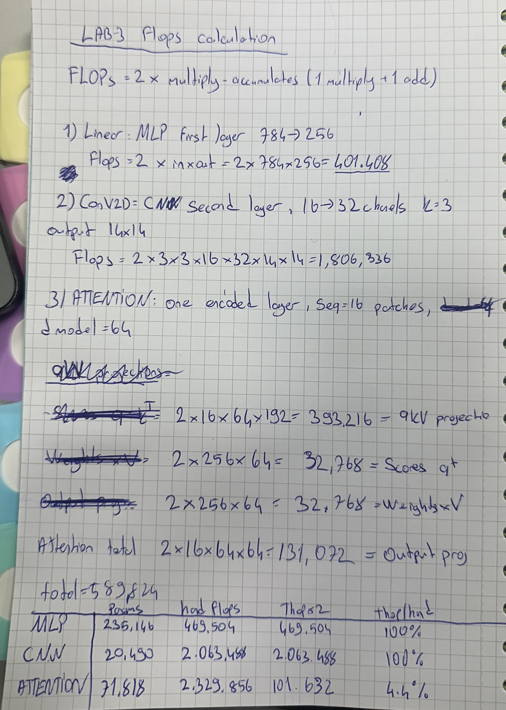

# Lab 3: Architectures and Their Costs

## 1. Goal

Implement three image classifiers in PyTorch (MLP, CNN, patch-based attention), count their parameters and FLOPs by hand and with profiling tools, measure inference latency at batch 1 and 128, train them on Fashion-MNIST, and decide which architecture is most cost-effective based on accuracy, parameter count, latency and memory access patterns.

## 2. Method

- **Environment:** same pinned environment as Lab 1 (versions in `results/versions.txt`). `OMP_NUM_THREADS=1` and `torch.set_num_threads(1)`, so all timings are single-threaded CPU on an Apple Silicon MacBook Pro. All four seeds set to 42.
- **Data:** `torchvision.datasets.FashionMNIST` with `ToTensor()` and `Normalize((0.2860,), (0.3530,))`. The official 60k training set is split into 55k train / 5k validation with a seeded `random_split`; the official 10k test set is used for test accuracy. Batch size 128.
- **Models** (exactly as specified, with one addition):
  - MLP: Flatten 784 → Linear 256 → ReLU → Linear 128 → ReLU → Linear 10.
  - CNN: Conv2d(1,16,3,p=1) → ReLU → MaxPool2 → Conv2d(16,32,3,p=1) → ReLU → MaxPool2 → Flatten → Linear(1568,10).
  - Attention: 16 non-overlapping 7×7 patches → Linear 49→64 → 2 × `TransformerEncoderLayer`(d_model=64, nhead=4, dim_feedforward=128, PyTorch default dropout 0.1) → mean pool → Linear 64→10. **Addition:** a learnable positional embedding (16 × 64 = 1,024 parameters). The spec does not include one, but without it the encoder plus mean pooling cannot tell which patch came from which part of the image.
- **Parameter target:** the lab asks for 100k–150k parameters per model, but the specified layers give 235,146 (MLP), 20,490 (CNN) and 71,818 (Attention). I kept the architectures exactly as specified and report the real counts.
- **Parameters:** `torchinfo.summary` (full layer tables in `results/torchinfo_summary.txt`).
- **FLOPs:** hand-calculated per layer with the Ch. 4 formulas (FLOPs = 2 × multiply-accumulates; bias, activations, pooling, softmax and LayerNorm ignored), compared with `thop.profile` at batch 1. thop reports MACs, so its result is multiplied by 2.
- **Latency:** `model.eval()` under `torch.inference_mode()`, 1 warm-up, then median of 100 runs at batch 1 and median of 20 runs at batch 128.
- **Training:** Adam, lr 1e-3, batch 128, 5 epochs, cross-entropy loss. Seeds reset before each model. Validation accuracy logged every epoch (`results/training_log.csv`), test accuracy measured once at the end.

## 3. Results

### Hand-calculated FLOPs for one layer of each type (batch 1)

| Layer type | Example layer | Formula | FLOPs |
|---|---|---|---|
| Linear | MLP 784 → 256 | 2 × 784 × 256 | 401,408 |
| Conv2d | CNN conv2, 16 → 32 at 14×14 | 2 × 3 × 3 × 16 × 32 × 14 × 14 | 1,806,336 |
| Attention: QKV projections | Encoder layer 1 | 2 × 16 × 64 × 3 × 64 | 393,216 |
| Attention: scores Q·Kᵀ | Encoder layer 1 | 2 × 16² × 64 | 32,768 |
| Attention: weights × V | Encoder layer 1 | 2 × 16² × 64 | 32,768 |
| Attention: output projection | Encoder layer 1 | 2 × 16 × 64 × 64 | 131,072 |

All layers of all three models are listed in `results/flops_by_layer.csv`.

### Parameters, FLOPs and latency (`results/cost_summary.csv`)

| Model | Parameters | Hand FLOPs | thop MACs × 2 | thop / hand | Latency batch 1 (ms) | Latency batch 128 (ms) | Per sample at 128 (ms) |
|---|---|---|---|---|---|---|---|
| MLP | 235,146 | 469,504 | 469,504 | 100.0% | 0.0146 | 0.0701 | 0.0005 |
| CNN | 20,490 | 2,063,488 | 2,063,488 | 100.0% | 0.0745 | 6.6008 | 0.0516 |
| Attention | 71,818 | 2,329,856 | 101,632 | 4.4% | 0.1379 | 4.0926 | 0.0320 |

### Why thop misses the attention FLOPs (`results/thop_fastpath_check.csv`)

| MHA fast path | thop MACs × 2 | thop / hand |
|---|---|---|
| Enabled (default) | 101,632 | 4.4% |
| Disabled | 1,182,976 | 50.8% |

thop counts FLOPs by attaching hooks to known leaf modules (`Linear`, `Conv2d`, ...). For MLP and CNN every operation runs through such a module, so thop matches the hand count exactly. For the attention model there are two separate problems:

1. **Fused fast path.** thop runs the model in `eval()` mode without gradients. In that mode PyTorch executes each `TransformerEncoderLayer` as one fused kernel, so the hooks on its inner layers never fire. thop only sees the patch projection and the classifier head (50,176 + 640 MACs), which is 4.4% of the total.
2. **Functional attention.** With the fast path disabled, thop picks up the two feed-forward layers per block (+1,048,576 FLOPs) and the four LayerNorms (+32,768 FLOPs, which the hand count deliberately ignores), reaching 50.8%. It still misses the QKV projections, Q·Kᵀ, weights × V and the output projection, because `MultiheadAttention` uses its weights inside a function call rather than through `Linear` modules, and thop has no rule for it.

The operations thop never counts add up to 1,179,648 FLOPs, which is 50.6% of the hand calculation and exactly the attention part of it. Profiling tools must be checked against a hand count, especially for attention models.

### Accuracy (`results/test_accuracy.csv`)

| Model | Test accuracy | Training time (5 epochs, s) |
|---|---|---|
| MLP | 0.8772 | 7.1 |
| CNN | **0.8982** | 42.3 |
| Attention | 0.8571 | 36.3 |

### Trade-offs (`results/tradeoff_table.csv`)

| Model | Achieved GFLOP/s at batch 128 | Test accuracy per 100k parameters |
|---|---|---|
| MLP | 857.3 | 0.373 |
| CNN | 40.0 | 4.384 |
| Attention | 72.9 | 1.193 |

## 4. Conclusions

1. **Parameters and FLOPs measure different things, and the CNN shows it best.** The CNN has 11× fewer parameters than the MLP but does 4.4× more FLOPs, because each small 3×3 filter is reused at every position of the image. The MLP is the opposite: every weight is used exactly once per image. Parameter count tells you about model size and memory; FLOPs tell you about compute. Neither predicts latency on its own.
2. **Memory access patterns explain why the most expensive model in FLOPs is not the slowest, and the cheapest in parameters is.** The MLP is one dense matrix multiplication per layer: weights are stored contiguously and, at batch 128, each weight is reused for all 128 images. This regular, high-reuse access lets the CPU reach about 857 GFLOP/s. The CNN's convolutions slide a small window over the image, reading many small, scattered pieces of the input and producing large intermediate activations (16 × 28 × 28 per image after the first layer), so it only reaches about 40 GFLOP/s and is the slowest model per sample despite doing fewer FLOPs than attention. The attention model is built from many small matrix multiplications (sequence length 16) plus reshapes, softmax and LayerNorm, so it sits in between (about 73 GFLOP/s) and has the highest batch-1 latency, where fixed per-operation overhead dominates.
3. **Which architecture is most cost-effective depends on which cost is limited.** The CNN gives the highest accuracy (89.8%) with the fewest parameters, so it is the best choice when model size or memory is the constraint (Mobile or TinyML targets from Lab 1). The MLP is 5× faster than the CNN at batch 1 and about 100× faster per sample at batch 128, for 2.1 percentage points less accuracy, so it is the best choice when CPU latency or throughput is the constraint. The attention model is not cost-effective at this scale: the CNN beats it on accuracy and parameters, and the MLP beats it on accuracy and latency. It also had not converged after 5 epochs (validation accuracy stayed at 0.858 in epochs 4–5). Attention needs more data, longer training and longer sequences to pay off.

## Hand-written work

